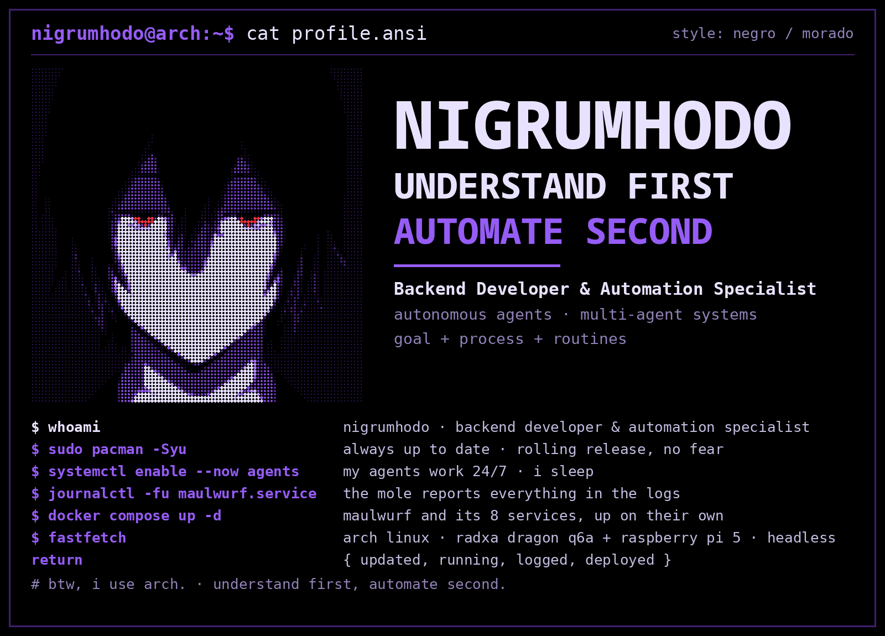

```text
nigrumhodo@github:~$ cat nigrumhodo.profile

role := Backend Developer & Automation Specialist
name := NigrumH0do
goal := build autonomous agents and multi-agent systems
        that work 24/7, on infrastructure that scales fast
rule := understand first, automate second

# 01 / about.me -------------------------------------------------
core := Java backends, n8n workflows, bash scripting,
        system integration
what_i_do := optimize workflows and build systems that
             bridge simple tools and enterprise needs.
             i don't just write code: i orchestrate
             solutions.

# 02 / now.working_on -------------------------------------------
agents {
  autonomous -> agents that own the goal, not the steps:
                goal + process + routines
  multiagent -> multi-agent systems coordinated over a
                message bus, handing work to each other;
                the human approves and decides
  learning   -> agent architectures, agent infrastructure,
                rapidly scalable applications
  running    -> headless Linux 24/7 (Debian/Arch/Ubuntu),
                systemd, auto-recovery
  hardware   -> Raspberry Pi 5, Radxa Dragon Q6A
}
```

```text
# 03 / experience ------------------------------------------------
[0] Virtual Bingo Infrastructure & Tooling
    role := Automation Developer
    tech := Java, SMTP, Image Processing
    did  := background editor for thousands of bingo
            cards + mass mailing of unique cards
            without ever hitting spam
    impact := a local, manual game -> a scalable service
              for massive virtual events

[1] High-Concurrency Event Management System
    role := Full Stack Automation Engineer
    tech := Google Apps Script, JavaScript, QR
    did  := registration and access control for 850+
            students a day, 99.9% uptime, batch writes
            every 5 min, custom JWT-style auth
    impact := the Google ecosystem pushed to its limit,
              with no external database

[2] Edge AI & Linux Infrastructure
    role := Embedded Engineer
    tech := Python, YOLO, n8n, Linux, Systemd
    did  := headless Arch on Radxa Q6A and RPi 5,
            real-time vision wired into n8n pipelines
    impact := systems that recover on their own
              and never sleep

# 04 / stack -----------------------------------------------------
languages  := [Java, Python, JavaScript, Apps Script]
automation := [n8n, GNU Bash, Docker]
infra      := [Debian, Arch Linux, Raspberry Pi OS, systemd]
agents     := [autonomous agents, multi-agent systems,
               agent infrastructure, scalable apps]

return { goal, process, rules, routine, next_step }
# understand first. automate second.
```
